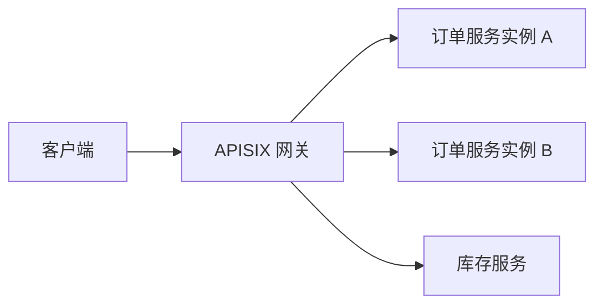

# 第 1 章：先认识 APISIX

[下一章：etcd 基础](02-etcd-basics.md)

## 1. 本章目标

读完本章，你应该能回答三个问题：

1. APISIX 在客户端与业务服务之间做什么？
2. Route、Upstream、Service、Consumer 和 Plugin 分别表示什么？
3. 哪些事情属于网关，哪些仍然属于业务服务？

## 2. APISIX 是什么

APISIX 是一个 API 网关，可以把它理解为业务 API 的统一入口。
客户端先访问网关，网关按照规则处理请求，再把请求转发给后端。
它负责路由、负载均衡、认证、限流、日志等通用流量处理能力。
它并不替代订单、库存、支付等业务程序。

APISIX 建立在 Nginx、OpenResty/Lua 生态之上：

- **Nginx** 提供网络连接、HTTP 处理和反向代理等基础能力。
- **OpenResty** 将 Nginx 与 Lua 等组件结合，支持可编程的请求处理。
- **Lua/LuaJIT** 承载 APISIX 的网关逻辑与内置插件逻辑。

这里描述的是技术关系，不是三个必须各自启动的独立服务。



> 图为简化概念模型：省略 TLS、网络连接、健康检查与部署细节。

没有网关时，多个业务服务可能分别实现认证、限流和访问日志。
有了网关，就能把适合统一处理的部分集中到入口，减少重复实现。
但业务规则不能因此全部搬进网关。

## 3. 五个核心对象

| 对象 | 回答的问题 | 例子 |
| --- | --- | --- |
| Route | 哪些请求匹配这条规则？ | `GET /orders/*` |
| Upstream | 请求转给哪些后端，如何选择？ | 两个订单服务实例，轮询 |
| Service | 哪些网关配置可以被多条 Route 复用？ | 共享订单服务的上游与插件配置 |
| Consumer | 通过认证识别出的调用方是谁？ | 某个合作方应用 |
| Plugin | 在处理过程中增加什么能力？ | 认证、限流、日志 |

### Route：请求匹配入口

Route 可以按 URI、Host、HTTP 方法等条件匹配请求。
匹配成功之后，APISIX 才知道应采用哪组插件和上游配置。
例如，`GET /orders/42` 可以匹配 `GET /orders/*`。
同一个路径的 `POST` 请求不一定匹配只允许 `GET` 的 Route。
没有匹配规则时，不能假定 APISIX 会自动发现业务服务并转发。

### Upstream：后端节点与转发策略

Upstream 描述后端地址、负载均衡策略、超时、重试和健康检查等。
它可以直接写在 Route 或 Service 中，也可以单独创建后被引用。
Upstream 的节点应指向真正提供 API 的业务进程。
网关选择一个节点转发，不代表它执行了节点里的业务代码。

### Service：配置抽象，不是业务进程

APISIX 的 Service 是可复用的网关配置对象。
它可以承载共享插件和 Upstream 配置，让多条 Route 引用。
**创建 Service 不会启动容器、监听业务端口或部署订单程序。**
名称相似也不意味着它就是 Kubernetes Service，或你的微服务进程。

Route 可以不使用 Service，直接配置 Upstream。
使用 Service 的价值是复用，而不是每条 Route 都必须多套一层。
如果 Route 与 Service 配置了同名插件，通常以 Route 层配置为准。
不要据此推断所有字段都会自动继承，或同名插件会逐字段深度合并。

### Consumer：调用方身份

Consumer 表示 API 调用方，需要与支持它的认证插件配合使用。
例如，认证插件把某个 API Key 识别为合作方应用的 Consumer。
它不一定代表一个自然人，也不等于业务数据库中的用户表。
仅创建 Consumer 对象，并不自动让所有 Route 开启认证。

### Plugin：按阶段执行的扩展能力

插件可以参与请求处理或响应处理，在支持的配置范围内启用。
例如，认证插件检查凭据，限流插件约束请求次数，日志插件记录访问。
插件的执行取决于**处理阶段和优先级**，不是 JSON 中的书写顺序。
同一阶段中，通常 `priority` 数值较高的插件先执行。
一个插件也可能实现多个阶段的方法，不能把它当作只运行一次的函数。

## 4. 用一个订单请求串起来

下面是 Route 请求体示例，旨在解释字段，不是完整启动教程。
`orders-a` 和 `orders-b` 是示例后端名，运行时必须能够解析并访问。

```json
{
  "uri": "/orders/*",
  "methods": ["GET"],
  "plugins": {
    "key-auth": {}
  },
  "upstream": {
    "type": "roundrobin",
    "nodes": {
      "orders-a:8080": 1,
      "orders-b:8080": 1
    }
  }
}
```

当客户端请求 `GET /orders/42` 时：

1. Route 匹配 URI 和 HTTP 方法。
2. `key-auth` 检查凭据；还需要另行配置 Consumer 及其认证信息。
3. 认证成功后，APISIX 从 Upstream 中选择可用节点。
4. 订单服务处理请求，响应经网关返回客户端。

这个例子没有配置 URI 重写，不能假设 `/orders` 前缀会自动去掉。
如果后端只接受 `/42`，需要明确配置相应的重写能力。

## 5. 认证不等于业务权限

认证回答“你是谁”，授权回答“你有没有资格做这件事”。
一个凭据合法的调用方，不一定有权查看订单 `42`。
订单归属、租户隔离、角色权限等，需要业务服务或明确的授权机制校验。
网关可以参与授权，但不能把“认证成功”直接当成“业务权限全部通过”。

同样，网关限流不保证数据库事务正确；网关重试也不保证写操作幂等。
网关与业务服务各自承担的边界，应在设计时明确。

## 6. 自测与官方资料

- Route 和 Upstream 分别解决什么问题？
- 为什么创建 APISIX Service 不会启动订单服务？
- 把认证插件写到 JSON 最后，能否让它最后执行？
- 合法 API Key 为什么仍可能无权访问某个订单？

官方资料：

- [APISIX 文档入口](https://apisix.apache.org/docs/apisix/)
- [APISIX 架构](https://apisix.apache.org/docs/apisix/architecture-design/apisix/)
- [Admin API 与资源定义](https://apisix.apache.org/docs/apisix/admin-api/)
- [插件开发：阶段与优先级](https://apisix.apache.org/docs/apisix/plugin-develop/)

下一章学习 etcd，理解这些网关配置可以如何保存和同步。
