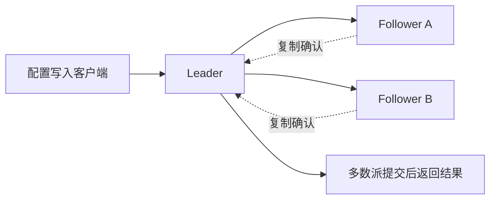

# 第 2 章：etcd 是什么，为什么适合保存配置

[上一章：APISIX 基础](01-apisix-basics.md) · [下一章：请求与配置链路](03-request-and-config-flow.md)

## 1. 本章目标

本章只建立理解 APISIX 配置中心所需的模型：

- etcd 保存什么样的数据？
- Raft 和多数派如何帮助集群保持一致？
- Watch 与 Lease 分别提供什么能力？
- 哪些数据不适合放进 etcd？

## 2. 名称与定位

etcd 的名称含义是 **distributed `etc` directory**，即“分布式的 etc 目录”。
这里的 `etc` 联系到 Unix 系统中常用于保存配置的 `/etc` 目录。
不要把它展开为没有依据的英文缩写。

etcd 是一个分布式键值存储，常被用作配置和协调服务。
“分布式”表示多个成员共同维护状态，而不是每个成员各存一套无关数据。
“键值”表示通过 key 查找对应的 value，不是用表关系表达业务模型。

例如，一个应用可以保存这样的概念数据：

```text
key:   /gateway/routes/orders
value: {"uri":"/orders/*","upstream_id":"orders"}
```

这里的 key 只是教学示例，不是 APISIX 的实际存储路径约定。
key 中的 `/` 可以帮助组织前缀，但不意味着 etcd 真有文件系统目录。
value 可以是 JSON 字符串；etcd 不会替你理解它是不是一条有效 Route。
配置是否合法，仍需要写入它的应用负责校验。

## 3. 强一致具体意味着什么

在默认的线性一致读取语义下，如果一次写入已经成功完成，
之后发起的读取不能返回比那次写入更旧的值。
并发操作可以理解为在一个符合实时先后关系的顺序中生效。
这帮助多个客户端对“当前配置是什么”形成一致认识。

但不能把 etcd 的全部读取都笼统称为强一致：

- 默认的 `linearizable` 读取需要协调，提供线性一致语义。
- 显式选择 `serializable` 读取时，可以从成员本地状态读取，可能落后。
- Watch 是异步事件流，也不能当作实时、线性一致的查询结果。

强一致不等于每个客户端此刻都已经更新自己的缓存。
存储写入完成与订阅者收到通知，是两个不同事件。

## 4. Raft 与多数派

etcd 通过 Raft 协议让成员对状态变更达成共识。
集群会选出 Leader，负责协调日志复制和提交。
客户端可以连接不同成员；这里不展开成员间转发细节。

对于由投票成员组成的集群，多数派数量是 `floor(N / 2) + 1`。
变更需要多数派参与，不能让两个彼此隔离的小群体各自提交冲突状态。



> 图为简化概念模型：省略选举、日志细节、持久化步骤与客户端超时。

| 投票成员数 | 多数派 | 可容忍同时不可用的成员数 |
| --- | --- | --- |
| 1 | 1 | 0 |
| 3 | 2 | 1 |
| 5 | 3 | 2 |

3 个成员中，只要仍有 2 个能够正常通信，就有可能继续完成共识。
如果其中 2 个不可用，剩下 1 个不能单独接收并提交写入。
多数派丢失时，集群无法提交新的写入，线性一致读取通常也会受阻。
允许旧数据的 serializable 读取可能仍由存活成员响应。
因此，“失去多数派后一切读写都一定不可用”也不是准确表述。

容错依赖可通信的多数派，不只是看进程列表里有没有活着的进程。
3 个成员如果全在同一台机器上，不能容忍这台机器整体故障。
本地单节点适合入门实验，不具备多节点容错能力。

## 5. Watch：订阅变化，不必不停查

客户端可以 Watch 某个 key 或某段 key 前缀。
当匹配范围发生写入或删除时，etcd 向订阅者发送事件。
这很适合配置系统：配置不频繁改变，但改变后要通知很多使用者。

例如，网关先取得当前 Route 配置，再订阅相关变化。
收到“订单 Route 更新”的事件后，网关更新自己的本地配置。
业务请求使用本地配置，而不是为了每个请求向 etcd 查一次。

etcd 使用递增的 revision 标识键值空间的修改版本。
Watch 事件按 revision 有序，客户端可以记录已经处理到的位置。
连接中断后，在相关历史仍保留时，可以从该位置之后继续订阅。
如果历史已被压缩，客户端需要重新同步，不能无限期回放过去。

Watch 也不保证所有订阅者在同一瞬间收到变化。
网络、处理速度和重连都会带来延迟，需要区分存储状态与本地状态。

## 6. Lease：给临时状态一个有效期

Lease 是租约，带有 TTL，即存活时间。
一个或多个 key 可以关联到同一个 Lease。
客户端通过 keepalive 续租；不续租，租约到期后相关 key 会被删除。
主动撤销租约也会删除与它关联的 key。

例如，某个实例可以把临时注册信息关联到租约：

```text
/services/orders/instance-a -> {"address":"orders-a:8080"}
                         关联一个需要续租的 Lease
```

实例停止续租后，注册信息可以随租约过期被清理。
这提供了临时状态的生命周期，但并不等于直接检查业务接口是否健康。
网络故障也可能导致续租失败，因此业务系统仍要正确处理失联情况。

Lease 是 etcd 的通用能力，不代表 APISIX 的每条 Route 都会自动过期。
长期保存的配置与带租约的临时协调数据，需要分清用途。

## 7. 为什么不把 etcd 当海量业务数据库

etcd 适合少量、重要、需要一致性的配置或协调数据。
典型场景包括网关配置、选主状态、服务注册和分布式协调。
不宜把订单明细、访问日志、视频文件或大量分析数据都放进去。

这些业务数据通常应该放到关系数据库、日志系统或对象存储等系统。
是否适用不能只看“它能不能保存 JSON”，还要看规模、查询方式与负载。
共识、存储维护、备份恢复也都有成本，不是免费获得的一致性。

## 8. 自测与官方资料

- 3 个投票成员为什么只能容忍 1 个同时故障？
- etcd 写入成功后，是否所有 Watch 客户端已经收到通知？
- `serializable` 读取与默认线性一致读取有什么不同？
- Lease 过期与 HTTP 健康检查为什么不是同一件事？

官方资料：

- [etcd FAQ：名称、定位与多数派](https://etcd.io/docs/v3.6/faq/)
- [etcd API 保证：一致性、Watch 与 Lease](https://etcd.io/docs/v3.6/learning/api_guarantees/)
- [etcd API：键值、Watch 和租约接口](https://etcd.io/docs/v3.6/learning/api/)

下一章把 APISIX 和 etcd 放在一起，分别追踪配置与业务请求。
