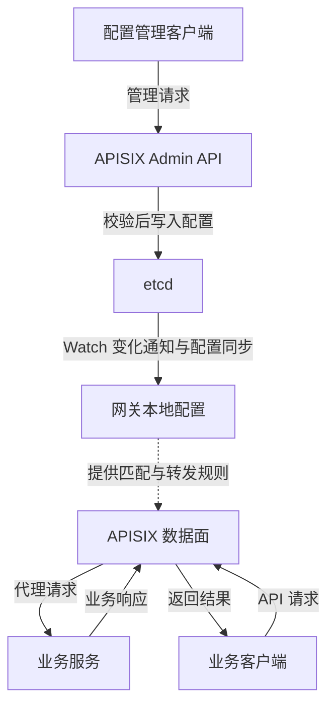

# 第 3 章：配置怎么变，请求怎么走

[上一章：etcd 基础](02-etcd-basics.md) · [下一章：本地快速实践](04-quickstart.md)

## 1. 先限定本章的部署模型

本章主要讨论 APISIX 的**传统 etcd 配置模式**。
在这种模式中，同一个 APISIX 实例可以处理管理请求和业务请求。
网关配置保存到 etcd，网关同步配置后在本地使用。

“控制面”和“数据面”是职责划分，不必等于两个独立进程：

- **控制面**：接收、校验、保存并分发网关配置。
- **数据面**：匹配业务请求、执行插件、选择后端并代理响应。

APISIX 也支持控制面与数据面分离的部署，以及不使用 etcd 的模式。
不能把本章的架构图推广为所有 APISIX 部署都必须如此。

## 2. 一张图区分两条链路



> 图为简化概念模型：本地配置抽象了同步器、缓存和 worker 使用的配置。
> 图不表示业务请求经过 etcd，也不展开各阶段、协议和重连机制。

抓住两个动词就不容易混淆：

- 管理请求在**改变规则**。
- 业务请求在**使用规则**。

## 3. 一条 Route 如何从配置变成可用规则

以“把 `/orders/*` 转给订单服务”为例：

1. 管理客户端向 Admin API 提交 Route 配置。
2. Admin API 校验配置格式及有关约束。
3. 在本章的模式下，配置写入 etcd。
4. 网关通过初始化读取与持续 Watch 等机制同步配置。
5. 网关把新配置加载到本地，后续请求使用更新后的规则。

首次启动不能只等增量事件，还需要取得所需的已有配置。
同步中断后也需要重连；历史不可用时可能需要重新取得完整状态。
这些是理解同步模型的要点，不是对具体内部实现逐行复述。

在此模式中，Admin API 写入成功，不等于所有网关都在同一瞬间更新完毕。
不同实例可能短暂使用不同版本的本地配置，应通过流量验证确认效果。
这不违背 etcd 的一致性：存储中的状态与客户端缓存是不同层次。

例如，把订单后端从 `orders-a:8080` 换成 `orders-b:8080`：

```text
修改前：Route -> Upstream -> orders-a:8080
写入后：etcd 已保存新的 Upstream 配置
同步后：网关本地配置 -> orders-b:8080
```

是否转发到新后端，应观察业务接口响应或访问日志，不只看配置写入响应。
已经发出的请求也不会因为配置改变而自动改成另一条正在进行的请求。

## 4. 一次业务请求的典型过程

假设已有 `GET /orders/*` Route，并配置认证与上游：

1. 客户端把 `GET /orders/42` 发到网关的业务监听端口。
2. APISIX 按 URI、方法等条件匹配 Route。
3. APISIX 在相应阶段执行认证、限流等插件逻辑。
4. 请求未被提前拒绝时，网关按 Upstream 配置选择后端。
5. 后端处理订单查询并返回结果。
6. 网关执行适用的响应处理、日志等阶段，将结果返回客户端。


> 图为简化概念模型：不是完整 Nginx/OpenResty 生命周期。
> 日志等阶段的实际时机由运行时决定，图中合并节点只用于解释职责。

插件并不是按 Route JSON 中的排列顺序执行。
阶段决定何时可以运行，同阶段的优先级影响先后顺序。
认证失败时，请求可以在访问后端之前被拒绝。

这条业务链路**不会为每个请求查询 etcd 来决定匹配哪条 Route**。
网关使用已经同步的本地配置；etcd 不负责代理 HTTP 业务流量。
某些插件可能访问 Redis、身份服务等其他系统，这是另一类外部依赖。
不能因为基础路由不逐次查询 etcd，就认为网关请求完全不访问外部系统。

## 5. etcd 故障时，哪些事情会受影响

| 操作或状态 | 典型影响 |
| --- | --- |
| 已启动且已经加载所需配置的网关代理请求 | 通常仍能使用已加载配置继续代理 |
| 通过 Admin API 创建或修改配置 | 可能因 etcd 不可达或无法形成多数派而失败 |
| 网关同步配置更新 | 可能暂停，无法取得新状态 |
| 网关冷启动或重启 | 可能因无法取得所需配置而受阻 |
| 上游服务或插件外部依赖故障 | 请求仍可能失败，不能归因于 etcd 一个组件 |

这里说的是“通常可继续”，不是无条件可用的承诺。
前提包括进程仍存活、本地配置已经加载、上游可达及其他依赖正常。
也不能把本地运行时配置当成一定存在的持久备份。

因此，不要遇到 etcd 故障就立即重启所有网关。
重启可能把“仍能按旧配置转发”变成“无法完成初始化”。
实际排查应先区分业务转发是否正常、配置是否过旧，以及同步是否恢复。

## 6. 管理入口与业务入口不能混用

业务端口面向 API 调用方，Admin API 面向配置管理者。
管理凭据与 Consumer 的 API Key 用途不同，不能混为一个权限体系。
知道一个合法业务凭据，不代表应该有修改网关 Route 的权限。

即使在本地学习，也应把管理认证和访问范围单独考虑。
生产环境应限制 Admin API 的网络暴露并配置认证等保护措施。
不要把管理入口当成公开业务接口，也不要把真实密钥写入 Git 仓库。

## 7. 其他模式：etcd 不是不可替换的前提

在控制面和数据面分离的 etcd 模式中，两种职责部署到不同实例。
虽然进程关系变了，配置链路与请求链路仍然应分开理解。

在 Standalone 文件驱动模式中，网关可以从本地 YAML 等文件加载配置。
此时不使用 etcd 作为配置中心，更新需要遵守对应模式的配置规则。
还存在面向特定集成的 Standalone API 驱动方式，不能照搬传统 Admin API。
具体角色、配置提供者和接口语义，以所选版本的官方部署文档为准。

本仓库后续实践若选择传统 etcd 模式，是为了学习完整配置同步链路。
这个选择不意味着所有场景都必须先部署 etcd。

## 8. 自测与官方资料

- 一次业务请求为什么不需要逐次查询 etcd？
- 配置写入成功，为什么不等于每个网关瞬间生效？
- etcd 不可达时，已有网关与刚启动的网关为什么可能表现不同？
- 为什么管理 API Key 不应该发给普通业务调用方？

官方资料：

- [APISIX 文档入口](https://apisix.apache.org/docs/apisix/)
- [APISIX 架构](https://apisix.apache.org/docs/apisix/architecture-design/apisix/)
- [APISIX 部署模式](https://apisix.apache.org/docs/apisix/deployment-modes/)
- [Admin API](https://apisix.apache.org/docs/apisix/admin-api/)
- [etcd Watch 与一致性保证](https://etcd.io/docs/v3.6/learning/api_guarantees/)

下一章运行本地环境，亲自验证“写配置”和“发请求”是两条不同链路。
