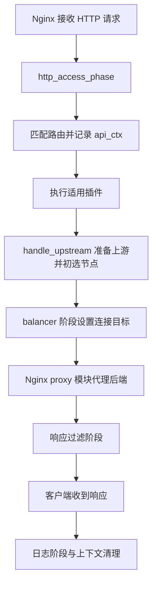

# 源码第 1 章：一次 HTTP 请求如何穿过 APISIX

[返回学习目录](../../README.md) · 前置：[基础路由实验](../04-quickstart.md)

## 1. 先确认开源范围和阅读版本

Apache APISIX 是 Apache 软件基金会的开源项目，主项目采用 Apache License 2.0。
官方源码仓库是 [apache/apisix](https://github.com/apache/apisix)。
核心网关逻辑主要使用 Lua，在 Nginx/OpenResty 的请求生命周期中运行；不是我们的 Python 演示后端。

本章以已经运行的实验版本 **3.14.1** 为准，不声称它是最新版：

```text
tag:    3.14.1
commit: 2f8ebf8527cdc878afe30100077c471879a5c133
```

文中的官方源码链接全部固定到该提交，避免主分支变化导致函数和行号对不上。
说明文字是学习笔记；标记为“原文摘录”的代码来自 Apache APISIX。
摘录的许可证和署名随文保留：[APISIX-LICENSE.txt](APISIX-LICENSE.txt)、[APISIX-NOTICE.txt](APISIX-NOTICE.txt)。
它们适用于所引用的上游内容，不是给本仓库所有原创材料擅自指定新许可证。

## 2. 本章只追一个请求

```http
GET http://127.0.0.1:9080/orders/123
```

实验路由匹配 `GET /orders/*`，Upstream 是 `orders-a:8080` 和 `orders-b:8080`。
先限定普通 HTTP 反向代理路径；不展开 TLS、HTTP/3、gRPC、Dubbo、Route script 等分支。



> 简化调用地图，不是完整 Nginx 状态机。日志不是客户端收到响应之前的必经处理门。
> `proxy_pass` 是代理配置指令，balancer 是建立上游连接时的钩子；不是两段互不相干的网络客户端。

## 3. 入口：Nginx 为什么会调用 Lua？

先看 [apisix/cli/ngx_tpl.lua:825–827](https://github.com/apache/apisix/blob/2f8ebf8527cdc878afe30100077c471879a5c133/apisix/cli/ngx_tpl.lua#L825-L827)。
这是生成 Nginx 配置的模板中的原文摘录：

```nginx
            access_by_lua_block {
                apisix.http_access_phase()
            }
```

Nginx 处理到 access 阶段，通过 OpenResty 的 Lua 钩子进入 APISIX。
所以 APISIX 不是在外面每次再启动一个 Lua 进程，也不是每请求运行命令行脚本。

模板还注册了 `balancer_by_lua_block`、`header_filter_by_lua_block`、`body_filter_by_lua_block` 和 `log_by_lua_block`。
它们把生命周期不同位置连接到相应的 Lua 函数。

阅读入口：[balancer 钩子 469–475](https://github.com/apache/apisix/blob/2f8ebf8527cdc878afe30100077c471879a5c133/apisix/cli/ngx_tpl.lua#L469-L475) · [响应和日志钩子 873–883](https://github.com/apache/apisix/blob/2f8ebf8527cdc878afe30100077c471879a5c133/apisix/cli/ngx_tpl.lua#L873-L883)。

## 4. 请求上下文：api_ctx 是什么？

[apisix/init.lua:674–680](https://github.com/apache/apisix/blob/2f8ebf8527cdc878afe30100077c471879a5c133/apisix/init.lua#L674-L680) 创建请求上下文，将它挂到 `ngx.ctx.api_ctx`。
可以把 `api_ctx` 理解为“这次请求的工作记录”，不同阶段通过它共享处理结果：

| 字段 | 本章里的意义 |
| --- | --- |
| `var` | 访问请求 URI、方法等 Nginx 变量的接口 |
| `matched_route` | 匹配出的路由对象 |
| `route_id` / `conf_version` | 路由身份与配置版本信息 |
| `plugins` | 当前请求筛选出来的插件及配置 |
| `upstream_conf` | 准备好的上游配置 |
| `picked_server` | access 阶段初选出的后端节点 |

这是请求级状态，不是所有用户共用的一份业务会话。
代码使用 table pool 降低表分配成本，但不能因此把不同请求理解成共享同一份逻辑上下文。

## 5. 路由匹配：JSON 如何成为匹配结构？

[init.lua:719–730](https://github.com/apache/apisix/blob/2f8ebf8527cdc878afe30100077c471879a5c133/apisix/init.lua#L719-L730) 调用 `router.router_http.match(api_ctx)`。
若没有匹配结果，适用的全局规则处理后，普通流程返回 `404 Route Not Found`。
这就是实验中 `POST /orders/123` 不匹配只允许 GET 的路由时观察到的网关 404。

### 5.1 默认路由器不能只看一个文件

[apisix/cli/config.lua:49–53](https://github.com/apache/apisix/blob/2f8ebf8527cdc878afe30100077c471879a5c133/apisix/cli/config.lua#L49-L53) 的默认配置指定 `radixtree_host_uri`。
[apisix/router.lua:71–84](https://github.com/apache/apisix/blob/2f8ebf8527cdc878afe30100077c471879a5c133/apisix/router.lua#L71-L84) 按最终配置加载对应模块；其中代码兜底是 `radixtree_uri`。
所以不能只看到兜底字符串，就断言正常默认启动使用 `radixtree_uri`。

本实验没有改 HTTP router 选项，按默认配置阅读 `apisix/http/router/radixtree_host_uri.lua`。
我们的订单 Route 没有 host 条件，因此进入该模块的 only-URI 路由分支。

### 5.2 树不是每个请求都重建

[匹配模块 145–157](https://github.com/apache/apisix/blob/2f8ebf8527cdc878afe30100077c471879a5c133/apisix/http/router/radixtree_host_uri.lua#L145-L157) 比较缓存的路由/Service 版本和当前本地配置版本。
首次使用或版本变化时，调用 `create_radixtree_router(user_routes.values)`；否则复用匹配结构。
构建时，[72–85 行](https://github.com/apache/apisix/blob/2f8ebf8527cdc878afe30100077c471879a5c133/apisix/http/router/radixtree_host_uri.lua#L72-L85) 把 URI、methods、priority 等整理成匹配项，并在命中后写入 `api_ctx.matched_route`。
[160–189 行](https://github.com/apache/apisix/blob/2f8ebf8527cdc878afe30100077c471879a5c133/apisix/http/router/radixtree_host_uri.lua#L160-L189) 准备方法、Host 等参数并进行 dispatch。

由此得到更精确的热更新模型：

```text
etcd 变化 → 配置同步器更新本地值/版本 → 后续 match 发现版本变化
        → 重建匹配结构 → 使用新规则匹配请求
```

版本检查不等于为每个业务请求调用 etcd。真实配置同步入口可从
[apisix/http/route.lua:138–150](https://github.com/apache/apisix/blob/2f8ebf8527cdc878afe30100077c471879a5c133/apisix/http/route.lua#L138-L150) 的 `core.config.new`、`automatic = true` 继续追踪。
Watch 重连、revision 和压缩恢复留到下一篇源码章节，不在本章假装已经逐行研究完。

## 6. 插件：不是按 JSON 顺序执行

[init.lua:784–824](https://github.com/apache/apisix/blob/2f8ebf8527cdc878afe30100077c471879a5c133/apisix/init.lua#L784-L824) 的普通分支：筛选插件 → 执行插件 `rewrite` → 处理 Consumer 配置合并 → 执行插件 `access` → 处理上游。

**容易混淆的细节：APISIX 插件的 `rewrite` 回调，在这里是由 `http_access_phase()` 调用的。**
不能只根据回调名称，就认定它一定对应 Nginx 的 `rewrite_by_lua` 钩子。
Nginx 生命周期阶段与 APISIX 插件内部阶段不是机械一一对应的。

[apisix/plugin.lua:86–92](https://github.com/apache/apisix/blob/2f8ebf8527cdc878afe30100077c471879a5c133/apisix/plugin.lua#L86-L92) 按 priority 降序比较，也有自定义 `_meta.priority` 的比较逻辑。
[1160–1238 行](https://github.com/apache/apisix/blob/2f8ebf8527cdc878afe30100077c471879a5c133/apisix/plugin.lua#L1160-L1238) 按阶段查找插件方法，传入配置和 `api_ctx`。
请求侧回调返回需要立即响应的结果时，框架可以调用 `core.response.exit`，不再继续代理后端。
响应过滤和日志分支的处理方式不同，不能套用“所有插件返回码都触发提前退出”。

订单基础 Route 没有插件配置，因此不是每个请求都自动认证、限流；后续章节会专门读 `key-auth`。

## 7. 上游：初选节点和连接设置是两步

[init.lua:563–580](https://github.com/apache/apisix/blob/2f8ebf8527cdc878afe30100077c471879a5c133/apisix/init.lua#L563-L580) 是 `handle_upstream` 的重要片段：

1. `set_upstream` 准备上游；它是 `apisix.upstream.set_by_route` 的别名。
2. `load_balancer.pick_server` 初选节点。
3. 把节点记录到 `api_ctx.picked_server`。
4. 设置上游请求头并执行适用的 `before_proxy` 回调。

这些动作在本章的普通流程中已经发生于 **access 阶段**，不能说“access 只做认证，balancer 阶段才第一次选节点”。

随后 Nginx 代理模块进入 balancer 钩子，
[init.lua:1063–1071](https://github.com/apache/apisix/blob/2f8ebf8527cdc878afe30100077c471879a5c133/apisix/init.lua#L1063-L1071) 调用 `load_balancer.run`。
[apisix/balancer.lua:341–393](https://github.com/apache/apisix/blob/2f8ebf8527cdc878afe30100077c471879a5c133/apisix/balancer.lua#L341-L393)：首次使用已选节点，后续重试分支可能重新选点，最后设置当前连接目标。
重试是否发生仍取决于上游和 Nginx 代理配置，不能读到分支就承诺所有错误都会重试。

## 8. 真正发出 HTTP 的是谁？

普通 HTTP 代理模板中的
[ngx_tpl.lua:867](https://github.com/apache/apisix/blob/2f8ebf8527cdc878afe30100077c471879a5c133/apisix/cli/ngx_tpl.lua#L867) 是原文摘录：

```nginx
            proxy_pass      $upstream_scheme://apisix_backend$upstream_uri;
```

APISIX 的 Lua 决定路由、插件行为、上游参数及连接目标；普通 HTTP 代理的连接与数据转发由 Nginx 代理模块承担。
不是 `init.lua` 自己为每个普通请求调用一个 Lua HTTP 客户端完成所有转发。
某些专用代理插件有不同路径，本章结论不覆盖那些分支。

响应回来后，模板连接 `http_header_filter_phase`、`http_body_filter_phase` 和 `http_log_phase`。
Body filter 可能按多个响应块触发，不一定整个响应只调用一次；不能把它当作只处理完整 JSON 的函数。

## 9. 先读这五处，不用从第一行开始

| 阅读顺序 | 文件与定位 | 要回答的问题 |
| --- | --- | --- |
| 1 | `apisix/cli/ngx_tpl.lua`：825、867、873 | Nginx 从哪进入 Lua，谁负责代理？ |
| 2 | `apisix/init.lua`：668、719、785、824 | 请求上下文、路由和插件怎样串起来？ |
| 3 | `apisix/http/router/radixtree_host_uri.lua`：72、145、160 | 配置如何形成匹配结构，什么时候重建？ |
| 4 | `apisix/plugin.lua`：86、1160 | 如何按阶段调用插件，什么时候提前响应？ |
| 5 | `apisix/init.lua`：563、1063；`apisix/balancer.lua`：341 | 初选节点与设置连接目标如何分工？ |

## 10. 小练习与后续节奏

1. `POST /orders/123` 被网关拒绝时，应先看路由匹配还是订单后端？
2. 如果把路由中的上游地址改了，为什么不必为此重写 Nginx 的 location？
3. `rewrite` 插件回调和 Nginx 的 rewrite 阶段为什么不能仅凭名字画等号？
4. 为什么只在 `http_balancer_phase` 找“第一次选节点”会漏掉实际代码？

本次只完成请求生命周期的源码导航和静态阅读，没有修改上游代码、重新编译 APISIX 或执行源码级单元测试。
此前的 Docker 实验验证是功能证据，不是本章所有内部调用的动态追踪证据。

后续按用户说“继续”推进，每次先讲解一章，再把经过核对的内容沉淀到仓库：

- 源码第 2 章：Admin API 写配置、etcd Watch 与本地版本更新。
- 源码第 3 章：`key-auth` 如何识别 Consumer，插件阶段与提前拒绝。
- 源码第 4 章：轮询、健康检查和重试的具体实现。

这些是待学习主题，不是已经完成并验证的章节。
